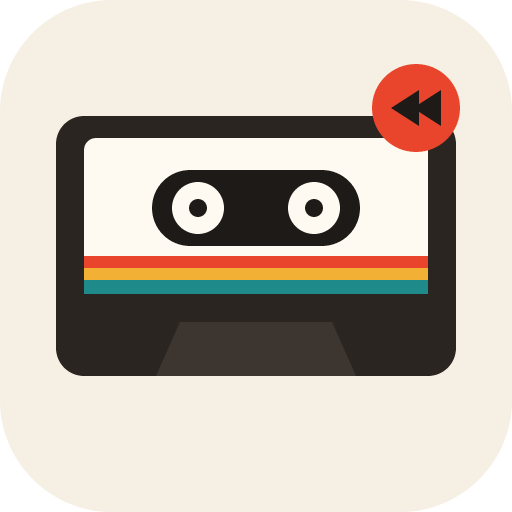

<p align="center">
  
</p>

<h1 align="center">Alderantziz</h1>

<p align="center">
  Say it backwards — a pass-the-phone party game: record a secret phrase, hear it reversed, imitate what you hear, and reverse the imitation to find out what you said.
</p>

<p align="center">
  <a href="https://github.com/Endika/alderantziz/releases/latest"></a>
  <a href="https://github.com/Endika/alderantziz/actions/workflows/ci.yml"></a>
  <a href="https://github.com/Endika/alderantziz/commits/main"></a>
  <a href="https://www.conventionalcommits.org"></a>
  <a href="./LICENSE"></a>
</p>

<p align="center">
  <a href="https://endika.github.io/alderantziz/"><b>▶ Play it now</b></a>
</p>

## How to play

1. **The secret.** One player records a word or a short phrase where nobody else can hear it.
2. **Imitate.** The phone goes to the next player, who hears it only backwards — as many times as they like — and records themselves repeating exactly what they hear.
3. **Reveal.** The app plays the real phrase, then the imitation turned around. The closer the imitator got, the more it sounds like the original.

## What you get

- One phone, no signup, no accounts.
- Recordings stay in memory on the phone: nothing is uploaded or saved, and a new round drops them.
- A cassette that spins while it records and flips over to side B when the tape runs backwards.
- Spanish, Basque and English.
- Installable as a PWA and playable offline.

## Development

```sh
npm install
npm run dev        # http://localhost:5173/alderantziz/
npm run test:run
npm run lint
npm run type:check
npm run build
npm run icons      # regenerate public/ icons from scripts/*.svg
```

Built with Vite, React, TypeScript, Tailwind CSS and the Web Audio API.

## License

[MIT](./LICENSE)
